# CGS2 Studio

给青萍空气检测仪 CGS2 的 14 款原生 Qt 表盘、Wi‑Fi 驱动修复与可回滚安装工具。

**支持：CGS2 / Linux 4.19.232 aarch64 / 固件 4.5.6_0167。** 这是社区改造项目，使用设备现有的原生传感器和 Qt 环境。其他型号、固件、内核不在支持范围内。

[安装与恢复](docs/INSTALL.md) · [表盘与交互](docs/FACES.md) · [NAS 相册、视频和音乐](docs/MEDIA.md) · [Codex Micro](docs/MICRO.md) · [声笺语音转文字](docs/VOICE.md) · [验证范围](docs/VALIDATION.md)

<table>
<tr><td>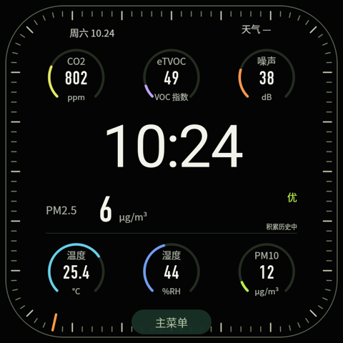<br>Ultra Modular</td><td>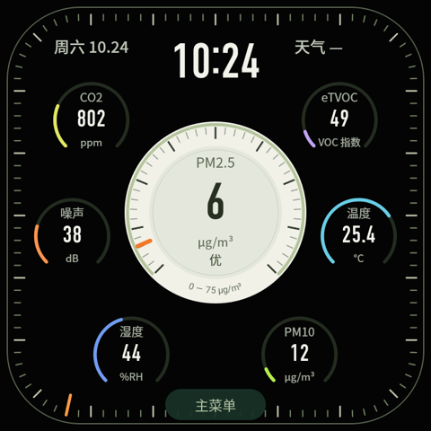<br>Air Wayfinder</td><td>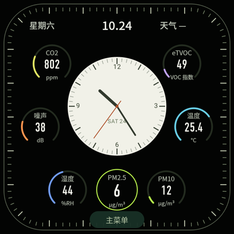<br>Infograph</td><td>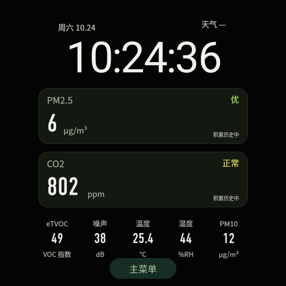<br>双模块</td></tr>
<tr><td>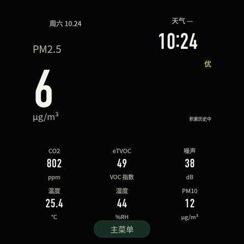<br>XL Air</td><td>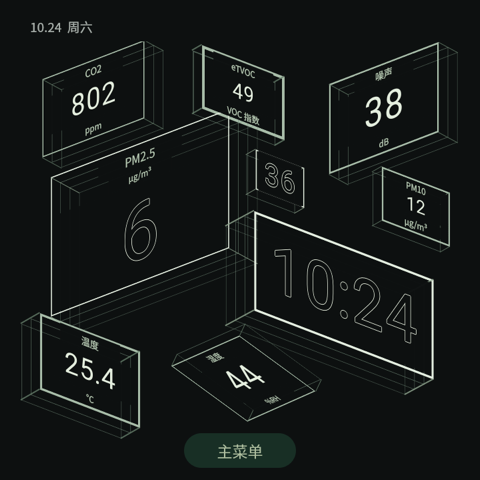<br>空间透视</td><td>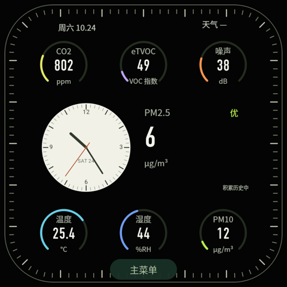<br>Chrono</td><td>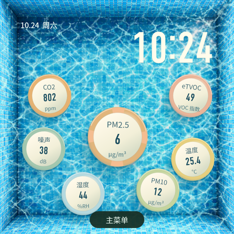<br>俯视泳池</td></tr>
<tr><td>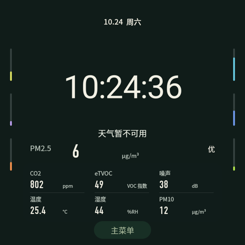<br>天气剧场</td><td>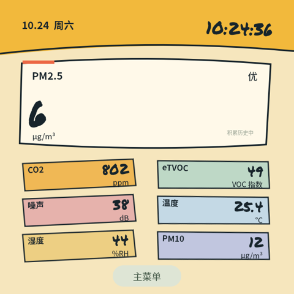<br>涂鸦气象</td><td>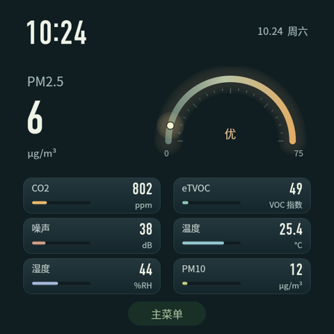<br>流光仪表</td><td>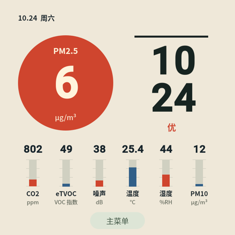<br>构成·空气</td></tr>
<tr><td>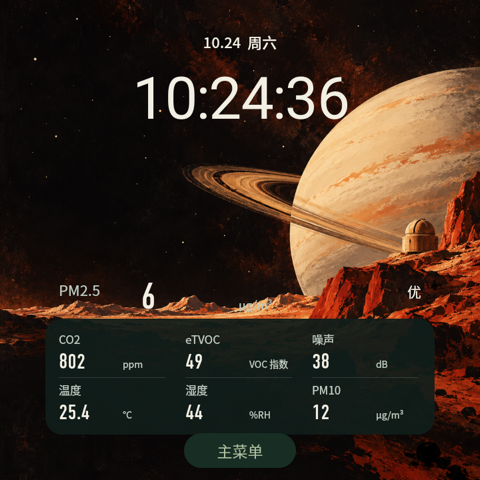<br>星际观测</td><td>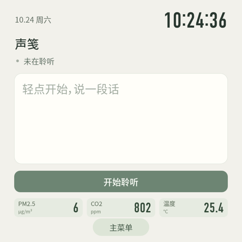<br>声笺</td></tr>
</table>

预览由设备 Qt 离屏渲染，使用固定示例读数。

## 功能

- 14 款表盘：从仪表盘、指针与数字布局，到正交透视、泳池、天气剧场、涂鸦、星际观测和声笺。
- 透视参数按不同朝向、尺寸和线宽排列；拖动视角跟随手指。泳圈随波摆动，拖放保留目标位置，覆盖的参数会避让。
- 12 类天气演示；按主题统一秒数显示；真实日期计算月相。星际观测不叠加天气浮层。
- 调整自动亮度曲线；60 秒无触摸后暂时降亮；所有表盘支持原生夜间息屏，首次触摸只唤醒。
- 可选 NAS 媒体服务：按文件夹选择照片，单独选择视频和音乐；照片、视频、音乐独立入口；3–60 秒随机轮播、提前缓存下一张、无切换音效；Live Photo 配对动态自动播放，播完再换图；视频默认静音。
- 可选 Apple Silicon 本地语音服务：实时部分转写，停止后处理已采集的尾段；不落盘保存麦克风音频或转写。
- Wi‑Fi 驱动锁顺序修复：从自己的原模块生成补丁，单次启动试用、确认后启用、未确认启动后回退。

传感器、表盘和本地历史不依赖 NAS、Mac 或 USB。照片、视频和音乐通过 Wi‑Fi 访问 NAS；USB / 无线 ADB 用于安装和调试。天气沿用原厂天气数据，数据不可用时会如实显示。

## Codex Micro

把触摸屏变成桌面控制面板：六枚任务状态键、方向摇杆、推理强度旋钮和可映射的快捷操作。可用动作由已连接的兼容服务声明，未配置的键会变暗。需要已有 NAS 网关与 Mac 适配器；此仓库提供设备端，不包含 ARL / Codex 桌面适配器。[功能与连接边界](docs/MICRO.md)。


## 安装

电脑需要 Python 3.10+、ADB，以及支持 AArch64 汇编的 clang。先确保自己能通过 USB ADB 进入设备 root shell，并保留可用的 USB 恢复方式。

```sh
git clone https://github.com/Geeprox/cgs2-studio.git
cd cgs2-studio
python3 tools/device.py
python3 tools/install.py
```

默认安装器只接受支持的原厂文件，先生成本地补丁包、在设备上备份，再更新和验证原生进程；不会改写 Wi‑Fi 密码、表盘偏好、传感器数据库或可选服务的密钥。已经改造过的设备需提供自己的原厂备份，多个连接需用 `--serial` 选择。[完整步骤与回滚](docs/INSTALL.md)。

Wi‑Fi 驱动是单独的可选步骤：

```sh
python3 -m venv .local/driver-venv
.local/driver-venv/bin/pip install -r driver/requirements-build.txt
.local/driver-venv/bin/python tools/wifi.py install
# 按安装说明手动重启、检查 Wi-Fi，再决定是否 enable。
```

**不会分发厂商程序、内核模块、无线固件或设备字体。** 构建器校验使用者设备文件的 SHA‑256，仅在本地提取所需回退 QML 和生成补丁。未知文件会被拒绝；不要把 `.local/` 上传到任何仓库或发布附件。

## 开发与验证

```sh
./tools/check.sh
python3 tools/check_release.py
cd integrations/media && npm ci && npm test
```

[验证记录](docs/VALIDATION.md)区分源码检查、仿真、隔离 Qt 渲染和真实设备验收。首次公开发布的通用安装器通过隔离文件系统成功/失败/回滚测试和实机只读预检、本地准备；尚未在另一台干净原厂设备完成首次安装。驱动尚无多日连续稳定性结论。

## 许可证

原创用户态代码与资产采用 [MIT](LICENSE)；`driver/` 中修复工具、汇编及加载器采用 [GPL‑2.0‑only](driver/LICENSE)。天文库、字体分别保留其上游许可证。[第三方说明](docs/THIRD-PARTY.md)。厂商文件的权利仍属于其权利人。

本项目不隶属于青萍，不是原厂固件。请先阅读[安全说明](SECURITY.md)。

## English

CGS2 Studio adds fourteen native Qt sensor faces, automatic/idle brightness and scheduled sleep, an opt-in Wi-Fi lock-order repair, and optional LAN media/local speech integrations to the Qingping CGS2. It targets only the exact CGS2 4.5.6_0167 / Linux 4.19.232 AArch64 profile. Vendor binaries are never distributed: tools derive local patches from the owner's exact-hash originals. Start with the [installation guide](docs/INSTALL.md), and review the [validation boundaries](docs/VALIDATION.md) before installing.
