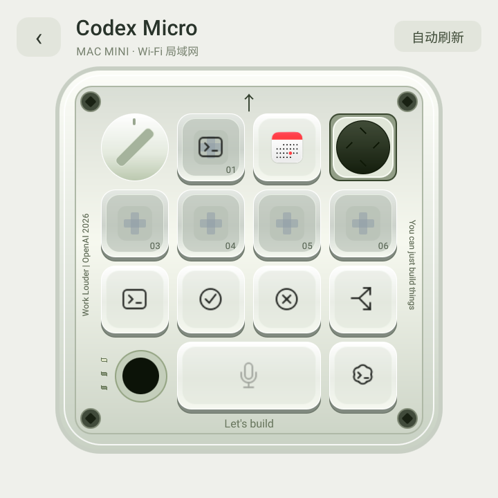

# Codex Micro

Codex Micro 把 CGS2 的触摸屏变成一个桌面控制面板：六枚任务键、方向摇杆、推理强度旋钮，以及可映射的快捷操作。它与表盘共用一个主菜单入口，离开面板后释放遥控状态。



配图直接截自运行中的 CGS2 屏幕，保留当前配置的应用和快捷键图标；没有重绘界面或模拟任务状态。不同使用者的键位映射和图标可以不同。

## 操作与反馈

- **六枚任务键**：显示槽位状态，蓝色运行中、黄色等待操作、绿色完成、红色错误、浅色空闲。任务是否可切换由已连接的服务决定。
- **旋钮**：左右拖动，松手后调节一级推理强度；只有服务声明支持时才执行。
- **摇杆**：滑动选定方向、松开执行。手势由摇杆独占，避免与左右切屏冲突。
- **快捷键**：可以映射任务、应用和服务支持的动作。批准、拒绝、派生任务等图标不代表服务一定提供对应能力；未配置或不可用的键会变暗并给出反馈。
- **听写键**：兼容服务可将按住/松开发送到 Mac 听写，使用的是 **Mac 麦克风**。表盘“声笺”则使用 CGS2 自己的麦克风，两者独立。

## 连接边界

这是可选的局域网集成功能，需要兼容的 NAS 网关和 Mac 适配器。设备通过已配对的 HTTPS 服务获取状态，命令受到活动控制租约与能力声明约束；断线后不会自动重放点击或命令。

本仓库包含 `qml/MicroPanel.qml`、手势和按键组件、`device/micro-client.sh` 及启动入口。**不包含 ARL / Codex 桌面控制适配器，也不提供一个通用、开箱即用的 Codex 官方远控 API。** 基础安装不会创建虚假在线状态，也不会覆盖已有的 Micro 配对。已有兼容部署可继续使用；独立 NAS 媒体服务仅提供媒体功能。

设备的传感器、表盘和本地历史不依赖 Micro 服务。

## 截取实际屏幕

在设备打开需要记录的页面，然后运行：

```sh
python3 tools/capture_screen.py --output .local/screens/micro.png
```

该工具只读当前 DRM 扫描缓冲区，不重启界面、不重新渲染，不改变屏幕尺寸。先检查截图中的任务名称、应用图标与其他个人信息，再决定是否分享。`tools/preview_device.py` 仍用于固定示例数据的表盘预览。
